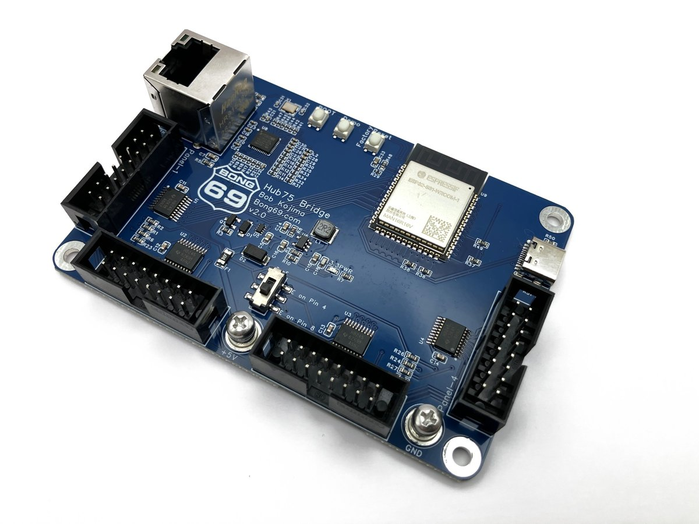
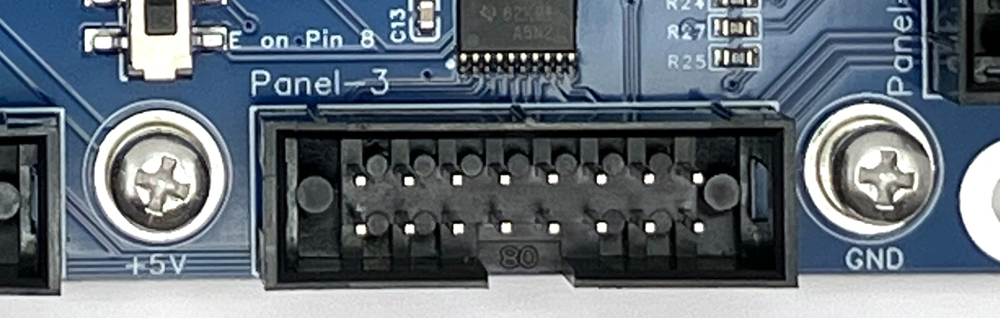
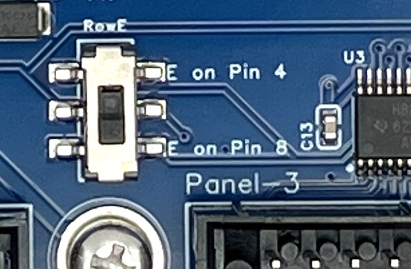
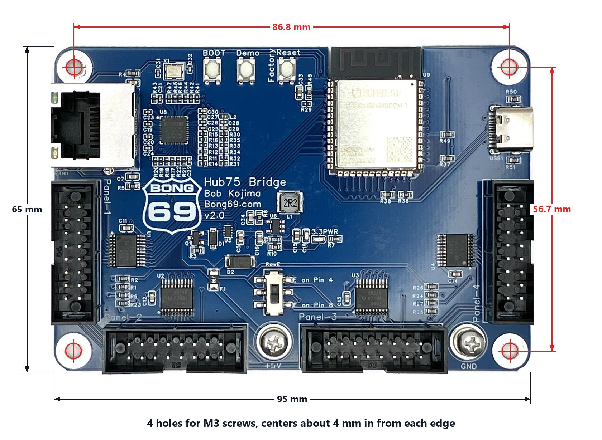

# HUB75 Bridge

This page answers questions about the HUB75 Bridge: what it is, how to set it up, and what to check when something doesn't look right.

- [Quick start guide](#quick-start-guide)
- [How do I add it to xLights?](#how-do-i-add-the-hub75-bridge-to-xlights)
- [Troubleshooting](#troubleshooting)

## What is it?
The HUB75 Bridge takes video over Ethernet and shows it on a wall of HUB75 LED panels. It receives DDP, the same protocol xLights and WLED use, and drives up to 4 chains of panels from one board.

- 4 HUB75 ports
- Gigabit Ethernet (wired only, no Wi-Fi)
- **16 panels (64 × 64) at 60 fps**, or **24 panels at 40 fps**
- Smooth dark shades: 11-bit color with a CIE brightness curve
- Set up from a web page: panel size, panel map, colors, brightness, password
- Built-in demos, so you can check your panels without a computer
- Firmware updates from the web page, no tools needed
- USB-C for programming

## Where can I get one?
You can buy the HUB75 Bridge [on Tindie](https://www.tindie.com/products/bong69/hub75-bridge-4-port-ethernet-controller-for-hub75/).

## What else do I need?
- **HUB75 LED panels.** Indoor panels in common sizes work: 32 × 16, 32 × 32, 64 × 32, 64 × 64, 128 × 32 and 128 × 64. Check the scan rate and driver chip before you buy: see [Which panels work?](#which-panels-work)
- **A 5 V power supply** big enough for your panels. The board needs very little: 5 V on its binding post from the same supply, or a USB-C phone charger.
- **An Ethernet cable** to your network, or straight to your computer.
- **Something that sends DDP**: [xLights](https://xlights.org/), our free [DDP Streamer](https://github.com/bobko69/ddp-streamer) (plays videos, your screen or a camera), or any other DDP sender.
- **HUB75 ribbon cables** between the board and the first panel on each port. Your panels usually come with them.

## Quick start guide

1. **Power.** The panels and the board are powered separately:
   - **Panels:** connect each panel's power cable to your 5 V supply. The board does not power the panels.
   - **Board:** 5 V DC on the binding post, or a USB-C cable. Ground goes to **-** and +5 V to **+**; check the markings on the PCB before you power up. The binding post can come from the same 5 V supply as the panels.

     

2. **Panels.** Plug a HUB75 ribbon cable from **Port 1** into the **input** of your first panel. Panels have an arrow on the back showing which way the data goes; the cable goes into the connector the arrow points away from. Chain more panels by connecting the first panel's output to the next panel's input.

3. **Ethernet.** Plug the board into your router or switch.

4. **Turn it on.** The panels stay dark. That's normal: the board waits for video.

5. **Press the Demo button.** The first demo shows the board's **IP address** on the panels, then the board steps through its other demos. If you see the demos, your power, cables and panels are working. Press Demo again to stop.

6. **Open the web page.** Go to **http://hub75bridge.local** in a browser on a computer or phone on the same network, or type the IP address from the demo. This works even if your panels can't show the demo yet (for example a different panel size than the board's default). The board also shows up as **hub75bridge** in your router's device list.

   **Using more than one HUB75 Bridge?** Set up one board at a time and give each one its own name in **Settings**, **Board name** (for example *stage-left*), then click **Save & Reboot**. After that it's at *stage-left*.local. If two boards still have the default name, the second one to start becomes **hub75bridge-2.local**, but which board gets which name can change after a power cut.

7. **Set up your panels** on the **Settings** page:
   - **Panel Size**: the size of one panel in pixels.
   - **Panels wide** and **Panels tall**: how many panels your wall has.
   - **Panel map**: fills itself in when you change the size (one row of panels per port). Change it if your wall is wired differently; see [How do I set up the panel map?](#how-do-i-set-up-the-panel-map)
   - Click **Save & Reboot**.

8. **Check the map.** On the Settings page, click **Show panel test on the wall**. Every panel shows its port's color and a label like **2-3** (Port 2, Panel 3). If a label is in the wrong place, fix that cell on the map and save again. If the colors look wrong (for example red shows as blue), see [The colors are wrong](#the-colors-are-wrong-red-shows-as-blue-and-so-on).

9. **Send video.** Set your DDP sender to the board's IP address and to the **Picture size** shown on the Settings page (for example 256 × 128). For xLights, see [below](#how-do-i-add-the-hub75-bridge-to-xlights).

10. **Before a show, give the board a fixed address.** The board gets its address from your router (DHCP) out of the box. xLights needs an address that never changes, so on the Settings page set **IP address** to **Fixed** and enter one, or set up a DHCP reservation in your router.

## What are the web pages for?
- **Stats**: what the board is doing right now: frames drawn per second, refresh rate, Ethernet link, packets received, and incomplete or skipped frames. Start and stop demo mode here.
- **Settings**: network, panel layout, demos, colors, brightness and password.
- **Layouts**: how many panels the board can run at each frame rate, measured on real panels, and how your current layout compares.
- **Wall Planner**: try out a wall before you build it: panel size, how many panels, how many ports, and the frame and refresh rates you'll get.
- **Update**: firmware update, settings backup, restart and factory reset.

## What do the buttons do?
- **DEMO**: start or stop the demos. The first one shows the board's IP address and name.
- **RESET**: hold for 3 seconds to go back to factory settings (one 64 × 64 panel on Port 1, address from your router, no password).
- **BOOT**: only for loading firmware over USB. You won't normally need it.

## Which panels work?
A panel works when all three of these are true. They're in the panel's listing or printed on its back.

| Check | Works | Doesn't work |
| --- | --- | --- |
| **Size** | 32 × 16, 32 × 32, 64 × 32, 64 × 64, 128 × 32, 128 × 64 | anything taller than 64 or wider than 128 (for example 256 × 128) |
| **Scan rate** = half the panel's height | 32 × 16 at 1/8, 32-tall at 1/16, 64-tall at 1/32 | a scan rate lower than half the height (most outdoor panels: 1/2, 1/4, 1/8 on a 32-tall panel, 1/16 on a 64-tall panel), and 1/64 scan |
| **Driver chip** | plain shift-register chips: ICN2037, FM6124, DP5020 and similar | PWM chips with built-in memory: ICN2153, MBI5153, FM6363 and similar. Listings for these usually say "3840 Hz" and "Novastar / Linsn / Colorlight". |

Pixel pitch doesn't matter: P2, P2.5, P3 and smaller or larger panels all work if they pass the three checks. Fine-pitch panels (P1.25 to P1.86) are the most likely to have PWM chips, so check those carefully.

## How many panels can it run?
Measured with 64 × 64 panels at 11-bit color:
- **16 panels at 60 fps** (4 ports × 4 panels), 138 Hz refresh
- **24 panels at 40 fps** (4 ports × 6 panels), 108 Hz refresh

Spread your panels across all 4 ports. Refresh rate depends on how many panels are on one chain, not on how many ports you use, so 4 short chains look better than 1 long one. Smaller panels (64 × 32 and down) refresh faster. The **Layouts** and **Wall Planner** pages on the board show the numbers for any layout.

## How do I set up the panel map?
The panel map tells the board where each panel sits on the wall, seen from the **front**. Each cell has two choices:
- **Port**: which HUB75 port the panel's chain is plugged into.
- **Panel**: where it is on that chain. **1** = the panel the cable from the board plugs into, **2** = the next one, and so on.

When you change the panel size or count, the map fills itself in with one row of panels per port, and Panel 1 on the side the cables come in from. Pick **Cables come in from the right / left** to match your wall, and click **Fill in** to start over at any time.

Then click **Show panel test on the wall** and compare. Port 1 is red, Port 2 green, Port 3 blue, Port 4 yellow, and each panel shows its port-panel label. A white frame steps along each chain from the board end, so you can see the order.

## Some of my panels are mounted upside down
Sometimes panels have to be turned over so the cables reach. Under the panel map, tick **Upside down** for that port. Every panel on that port then shows its part of the picture turned the right way up. On small walls this makes no difference. On big walls it costs some speed, because the board turns every frame over: with 24 panels at 40 fps it drops to about 35 fps. If you can, mount the panels the right way up on large walls.

## How do I add the HUB75 Bridge to xLights?
1. Give the board a **fixed IP address** first (Settings page, **IP address: Fixed**).
2. On the **Controllers** tab, click **Discover**. The board shows up as a DDP controller. You can also click **Add Ethernet** and type in its IP address.
3. Select the board and set:
   - **Protocol**: DDP
   - **Keep Channel Numbers**: **unticked**. This one matters: with it ticked, xLights sends the wrong channel numbers and the panels stay dark.
   - **Channels**: picture width × height × 3. For a 256 × 128 wall that's 98304.
4. Click **Save**.
5. On the **Layout** tab, add a **Matrix** model:
   - **Direction**: Horizontal
   - **# Strings**: the picture height (128 for a 256 × 128 wall)
   - **Nodes/String**: the picture width (256)
   - **Strands/String**: 1
   - **Starting Location**: Top Left
   - **Don't Zig Zag**: ticked
   - **Start channel**: the start of the board's controller (channel 1 on it)
6. Save, and play a sequence.

Once our controller file is in xLights, Discover will show the board as Vendor **Bong 69**, Model **HUB75 Bridge**, and untick Keep Channel Numbers for you.

## Can I use it without xLights?
Yes. Anything that sends DDP (UDP port 4048) works. In the DDP Streamer, click **Find boards** and pick the bridge. Our free [DDP Streamer](https://github.com/bobko69/ddp-streamer) for Windows, Mac and Linux plays videos and playlists, mirrors your screen, or shows a camera on the wall, and can span one picture across several bridges. Set the picture size to the **Picture size** shown on the board's Settings page.

## How do I change the brightness?
Settings page, **Brightness (%)**. The wall changes as you move the slider and the setting is saved when you let go, with no reboot. Lower brightness also means less heat in the panels.

## What do the color settings do?
**Color Quality** has three choices:
- **Best dark detail (11-bit)**: recommended. Smooth fades and dark shades.
- **Brightest (11-bit)**: a little more light, a little lower refresh.
- **Classic (8-bit)**: highest refresh rate, fewer dark shades.

Click **Show fade test on the wall** to see the difference while you change them. Leave **Advanced color settings** alone unless you see a problem; each one has a short explanation on the page.

## What is the E switch for?
64 × 64 panels need a fifth row address line, called E. The small switch near the ports picks which pin of the HUB75 connector carries it: **pin 8** for most 64 × 64 panels, **pin 4** for some. If a 64 × 64 panel shows only half its rows, try the other position. 64 × 32 and smaller panels don't use E, so either position works for them.

## How do I update the firmware?
- **From the web page** (the easy way): download the latest `.bin` from [Releases](https://github.com/bobko69/Hub75_Bridge/releases). Open the board's **Update** page, choose the file and click **Upload & Flash**. The board restarts on the new firmware. Your settings are kept.
- **Over USB**: if the board won't start or you can't reach its web page, connect it to a computer with a USB-C cable and use the [web installer](https://www.bong69.com/install/) in Chrome or Edge.

## How do I back up my settings?
On the **Update** page, click **Download settings** to save a file. **Load settings from a file** puts them back, on the same board or another one. Network settings are left out unless you ask for them, so a second board doesn't end up with the first one's IP address.

## How do I put a password on it?
Settings page, **Password**. It protects the Settings and Update pages; Stats and Layouts stay open. If you forget it, see [I forgot my password](#i-forgot-my-password-or-cant-reach-the-board).

## What are the board's dimensions and mounting holes?

- Board: 95 mm × 65 mm
- Mounting holes: 4, for M3 screws, one in each corner about 4 mm in from both edges
- Hole spacing: about 86.8 mm along the long side, 56.7 mm along the short side

A 3D-printable board mount is free on Printables, in the same listings as the panel brackets: [P2 64 × 64 brackets](https://www.printables.com/model/1871988-hub75-p2-64x64-brackets) and [P2.5 64 × 32 brackets](https://www.printables.com/model/1870398-hub75-p25-64x32-brackets).

## Where can I get the STL files for panel brackets?
Brackets that join panels into a wall are free on Printables:
- [P2 64 × 64 brackets](https://www.printables.com/model/1871988-hub75-p2-64x64-brackets)
- [P2.5 64 × 32 brackets](https://www.printables.com/model/1870398-hub75-p25-64x32-brackets)

## Does it have Wi-Fi?
No. The board uses wired Ethernet only. Video for a big wall is a lot of data at a steady rate, and a cable delivers it without dropped frames. The module on the board has a Wi-Fi radio, but the firmware doesn't use it.

## Where can I find the driver for the USB-C port?
You don't need one. The board uses the chip's built-in USB port, which Windows, Mac and Linux recognize without a driver.

## Is it open source?
No. The firmware and the board design are not open source. The firmware is free to download and use on the HUB75 Bridge. It uses some open-source software; see [Open-source notices](./OPEN_SOURCE_NOTICES.md).

## How do you test the boards before shipping?
Every board is flashed over USB-C, which tests the USB port. At startup the firmware checks every HUB75 signal for shorts and stuck pins. Then the board goes on our test fixture: it has to get a gigabit Ethernet link, show the test picture on a panel on each of the 4 ports, and pass the Demo and Reset buttons. Last, it's reset to factory settings, so it reaches you ready to set up.

# Troubleshooting

## The panels stay dark
- **Press the Demo button.** If the demos show, the board and panels are fine and the problem is the video source; see [Demos work, but nothing from xLights](#demos-work-but-nothing-shows-from-xlights-or-my-ddp-sender).
- If the demos don't show either:
  - Check the panels have power. Most panels have no power light, so measure 5 V at the panel's power connector.
  - Check the ribbon cable goes into the panel's **input**, not its output (follow the arrow on the back).
  - Check the cable is in the right **port**, and that the panel map has a panel on that port.
  - Try another ribbon cable. They do fail.

## Demos work, but nothing shows from xLights or my DDP sender
- **Keep Channel Numbers** must be unticked on the controller in xLights.
- The picture size you send must match the **Picture size** on the Settings page exactly.
- Is the sender pointed at the board's current IP address? Press Demo to see it on the panels.
- Is the board in demo mode? Demo mode ignores DDP. Press Demo, or click **Stop Demo Mode** on the Stats page.
- The **Stats** page shows whether DDP frames are arriving.

## The picture is in the wrong place, or split up
The panel map doesn't match how your wall is wired. Click **Show panel test on the wall** and fix the cells that show the wrong label. See [How do I set up the panel map?](#how-do-i-set-up-the-panel-map)

## Part of the picture is upside down
Tick **Upside down** for that port under the panel map. See [Some of my panels are mounted upside down](#some-of-my-panels-are-mounted-upside-down).

## The colors are wrong (red shows as blue, and so on)
Panels don't all use the same color order. On the Settings page, under **Color Order**, click **Show color test on the wall**. Every panel shows a red, a green and a blue bar, labeled R, G and B. Change a port's color order until each bar matches its letter; the wall updates as you change it. Then click **Save & Reboot**. Each port has its own setting, so a wall of mixed panels works.

## 64 × 64 panels show only every other block of rows
The E line isn't reaching the panel. Set the E switch to the other position. See [What is the E switch for?](#what-is-the-e-switch-for)

## I see flicker or bands on my phone camera
Phone cameras show flicker below about 100 Hz refresh. To raise the refresh rate:
- Use more ports with fewer panels on each chain.
- Try **Color Quality: Classic (8-bit)**.

The **Layouts** page shows the refresh rate you get for each layout.

## The video stutters or drops frames
- Check the **Stats** page: it shows the Ethernet link speed and counts incomplete frames and frames skipped because they came in faster than the board draws them.
- At 1 Gbps the board asks senders to slow down with Ethernet flow control. Some switches ignore that. If frames drop, set **Ethernet Link Speed** to **100 Mbps** on the Settings page. At 100 Mbps the board still does about 60 fps on 16 panels, or 30 fps on 32.
- Is the layout within the board's limits? See [How many panels can it run?](#how-many-panels-can-it-run)

## I can't find the board on my network
- Go to **http://hub75bridge.local** in your browser. If you gave the board its own name, use *that name*.local. With more than one unnamed board on the network, try **hub75bridge-2.local**, **-3** and so on.
- Press Demo: the first demo shows the IP address.
- xLights **Discover** and the DDP Streamer's **Find boards** list every bridge on the network.
- With no router (the board plugged straight into a laptop), the board picks a **169.254.x.x** address, the same way a PC does. Press Demo to see it.
- Check the Ethernet lights on the board's jack.

## I forgot my password, or can't reach the board
Hold the **RESET** button for 3 seconds. That resets **all** settings to factory defaults: no password, address from DHCP, one 64 × 64 panel on Port 1. Then set up the board again from step 5 of the [Quick start guide](#quick-start-guide).

## The panels show garbage that stays
The panels should stay dark while the board starts. If they show random pixels that don't go away, the board isn't starting: try the [web installer](#how-do-i-update-the-firmware) over USB.

## Where can I get more help?
Send us a message through [bong69.com](https://bong69.com/contact.html) or on Tindie. Tell us your panel size, how many panels are on each port, and what the Stats page shows. A photo or short video helps a lot.
